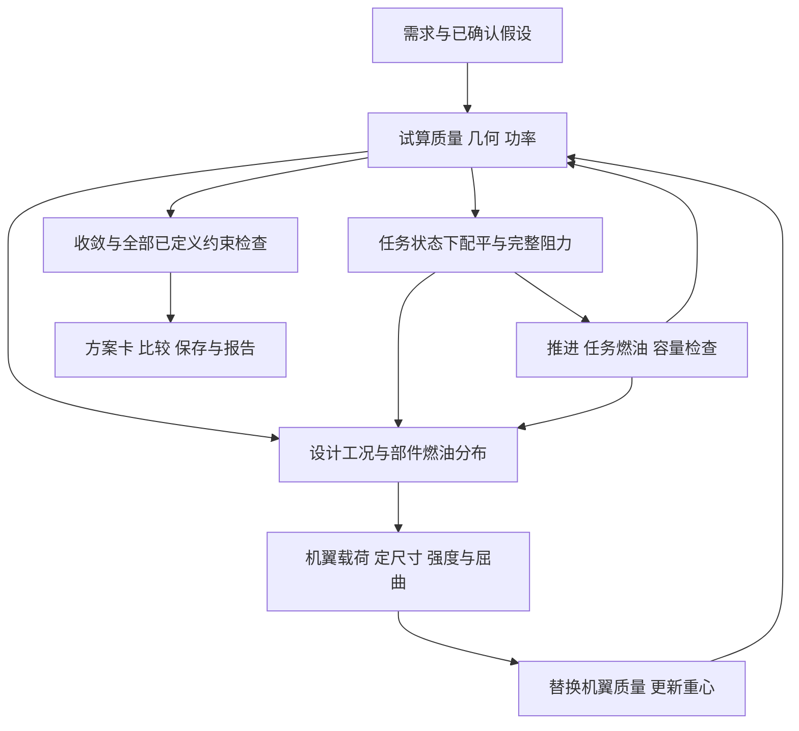

# V0.2.2 后路线复核与闭环推进建议

日期：2026-11-16。核查基线：`main/d38b795`，软件 V0.2.2；开始时工作区和暂存区干净。本次为代码、接口、既有验证证据和路线的审查，不产生新的求解器运行或版本验收。以下细分节点为推进建议，工程假设在对应版本开工时确认。

## 结论与产品目标

大方向保持不变：少量需求 → 确认任务和假设 → 正向设计 → 初步参数、约束余量及可复算的方案比较。

现已完成的连接是“总体 → OpenVSP → AVL”。总体内部已有重量—燃油—功率迭代，但实际 AVL 尚未返回任务积分；结构案例也尚未返回新飞机的部件重量。因此，下一目标是逐步把这条正向链变成多学科反馈闭环。建议继续 V0.2.3 配平，随后完成气动—任务反馈，再接实际机翼载荷与结构重量。部件质量、燃油状态和载荷接口提前设计，完整桨图和全部高保真能力不作为所有接口工作的前置条件。

V0.3.0 的气动/推进增强和 V0.4.0 的载荷/结构反馈两项里程碑保留。首个结构反馈以机翼为范围，其余主要部件暂用 FAST-GA 经验重量；全机主要部件工程估算和 AAA 十模块仍属最终范围。

## 1. 当前到底闭合了什么

| 环节 | 实际代码和证据 | 当前状态及含义 |
|---|---|---|
| 少量需求、任务、重量模式 | `requirements.py`、V0.2.0 流程验证 | 三种重量模式、四类任务、储备、方案比较、保存重开已接通 |
| 重量—燃油—功率—定尺寸 | `sizing.py`、`sizing_physics.py`、`fastga_mass.py` | FAST-GA 原生重量组＋项目任务积分/外迭代；任务使用规定抛物线极曲线及常数桨效率 |
| 同一方案的全机几何 | `geometry_service.py`、`aircraft_geometry.py`、V0.2.1 验证 | 收敛总体结果生成全机外形、参考量和分析截面；结构承力布局尚未从该几何生成 |
| AVL 联合升力面 | `aero_service.py`、`avl_aircraft.py`、V0.2.2 验证 | 主翼、平尾、垂尾联合计算，工况/舵面/参考量已明确；固定角度分析，尚未求配平 |
| 气动返回总体 | `sizing_physics.flight_power` 仍直接读取 CD0/e/AR | 未接通；改动 AVL 的计算结果目前不会直接改变总体耗油和功率 |
| 载荷、静力和屈曲 | `flight_loads.py`、`fea_mesh.py`、V0.1.3～V0.1.5 验证 | 合成矩形半翼、梁壳与代表板已有验证；尚未使用本机梯形翼、全机配平载荷和任务燃油状态 |
| 结构定尺寸与质量回写 | `fastga_mass.py` 仍输出经验重量 | 未接通；尚无按本机载荷定尺寸后替换机翼经验重量的运行路径 |

V0.2.2 基准固定迎角 3°，CL≈0.439045、Cm≈−0.166142，不能作为已配平的设计载荷。既有 262 项本地回归和 34 项阶段检查证明各自声明的接口/数值行为；本次读取这些记录，未重新运行测试，也未增加独立物理精度证据。

## 2. 必要前置任务及先后关系

### 配平先确定主翼和平尾分别承担多少载荷

V0.2.3 在同一几何、质量、重心和工况下求迎角与升降舵。首步是升力面模型的升力/俯仰矩平衡，输出主翼/尾翼分担、诱导阻力、实际残差和舵量余量。求解器迭代结束后重新计算真实残差，不能只使用一次线性导数预测。

随后用于任务时，扩展为所选模型下的纵向力和俯仰矩平衡：把机身、推力线、动力影响以及相应遗漏/近似逐项列入模型账目。爬升使用对应航迹角和平衡条件。推力线力矩可以先用明确几何与推力关系；螺旋桨滑流精细模型是后续精度增强。原生舵偏导数仍按已有近似边界使用。

当前零安装角模板保持为起点。如果无解，报告原因；需要调整尾翼安装角或尺寸时，应形成显式构型变更，更新 OpenVSP 和 AVL 一致模型后复算。报告局部纵向静稳定导数和控制余量，避免将一个可配平点等同于完整操稳通过。

### 阻力账目齐备后，实际气动才能驱动燃油

完整阻力按来源拆分：AVL 升力系统诱导阻力＋XFOIL 翼尾剖面阻力＋机身/起落架等非升力部件寄生阻力＋独立列出的修正项。已经计入翼尾剖面阻力的面积不得再进入同一寄生阻力项；尾翼配平引起的贡献也只计算一次。任何翼型力矩修正须说明与 AVL 原模型的差分关系，避免重复叠加。

XFOIL 的匹配条件包括实际翼型、雷诺数、马赫数、转捩及舵偏。先覆盖巡航、爬升、留空所需的有限工作域；缺失极曲线、未收敛或越界明确返回诊断。失速/增升参数继续采用另行声明的经验或数据方法，不从线性 AVL 外推。可使用有界插值及缓存，须检查插值误差与边界。

在已验证工况域内，先用现有可见的推进/耗油假设完成新气动到任务的反馈，再单独替换发动机—CCBlade 图谱，便于辨认气动与推进各自带来的差异。V0.3.0 是否达到物理精度要求仍依据独立数据，不以计算链收敛替代。

### 质量与燃油需要从一个总数变成一致的工况台账

`sizing.cg_ledger` 当前按 airframe/propulsion/systems/furniture 等大类给定经验站位，机体质量集中在 0.44 倍机身长度，燃油集中在主翼四分之一弦位置。它适用于现有概念估算，但不足以直接给实际机翼卸载和结构重心反馈。

从 V0.2.3 开始定义共同的飞行状态：几何版本、工况质量、CG、任务段、速度/高度、燃油状态、控制量与各项来源。先显式记录已有站位假设；在进入结构前拆成部件台账和分油箱质量/位置，保留加总和一阶质量矩守恒。

- 设计起飞重量、实际装载质量、该飞行点质量分别记录。规定重量模式中的未分配预算保持为预算；分析规定满载状态时，尚缺质量的站位须显式给出假设，不能自动生成压舱物。
- 任务耗油、储备油、滑行油和不可用油沿用既有口径。储备随飞机携带，不能又作为额外飞行任务消耗；不可用油在空重中只出现一次。
- 油箱容量从现有体积分数逐步转为结构布局限定的可用容积，记录占用、膨胀余量等选定假设。燃油消耗顺序和分布同时影响 CG 与机翼惯性卸载。
- 满油与低油状态均检查；低油时卸载减小可能增加某些部位的净载荷，不能只检查最大起飞重量或按总质量线性缩放所有载荷。

### 结构定尺寸之前，先把本机几何、载荷与质量对上

当前结构半翼是独立 NACA0012 矩形模板，实际全机模板主翼为 NACA2412 梯形翼。新结构模型应由本机的展长、弦长、翼型、站位生成，固定首期两梁金属翼盒，显式定义肋距、蒙皮/腹板/梁缘及所采用的加筋形式。

设计载荷来自选定工况的全机平衡和主翼/尾翼分担，再组合结构、燃油、设备的重力/惯性项。限制与极限工况分开，安全系数只施加一次。首个结构闭环采用声明范围内的对称准静态机动和燃油状态；阵风及集中载荷按 V0.4.0 门槛逐项补齐。

现有 AVL 条带是轴向/法向投影与局部展向偶矩，完整六分量标志为 false。先明确首期梁/壳实际需要的载荷分量；缺项通过可核验的求解器输出或有依据的单独模型补齐，逐半翼核查根部剪力/弯矩/扭矩，不能用全机左右抵消掩盖半翼误差，也不能平摊总残差制造完整输入。

V0.1.5 的宽薄无加筋合成蒙皮超限保留为旧案例结论。新机翼必须重新计算；其定尺寸约束同时覆盖应力、变形、局部屈曲和选定的制造下限。不能把局部稳定性失败的结构质量作为“已通过设计”的质量回写，也不能靠统一放大系数隐藏未计入的承力构件。

## 3. 建议细分节点

以下为下一阶段排程建议，保留大里程碑；每版开工再冻结输入、数值门槛和案例，不预先宣称完成。

| 节点 | 有界交付 | 通过条件 |
|---|---|---|
| V0.2.3 | 小迎角纵向配平；最小飞行状态/质量来源约定 | 实际 CL/Cm 残差、迎角/舵偏范围、CG 和尾翼载荷传递；正常、无解、超限均可复算 |
| V0.2.4 | 配平工况的 XFOIL 剖面阻力、非升力部件阻力及可查询气动模型 | 阻力分项无重计；匹配工况的公开/独立检查与离散敏感性；覆盖范围和缺失点清楚 |
| V0.2.5 | 新气动模型进入现有任务/燃油/功率及总体迭代 | 同需求下旧/新方法对照；质量随任务变化；三种重量和四类任务仍正确；一键完成、保存及比较 |
| V0.2.6～V0.3.0 | 有界发动机—CCBlade 图谱替换及气动/推进阶段验收 | 推力/功率/效率与耗油来源一致；独立数据角色明确；同条件任务与约束检查，完成专业问题复核 |
| V0.3.1 | 本机参数化结构、部件/油箱台账及设计载荷 | 实际几何与材料/连接假设一致；工况质量/CG、半翼载荷与守恒映射通过 |
| V0.3.2 | 机翼快速定尺寸和质量生成 | 多工况应力/变形/屈曲与制造边界；构件质量/CG可追溯；不满足项明确阻止“通过”状态 |
| V0.3.3～V0.4.0 | 代表件有限元对照、机翼重量替换及总体反馈 | 同几何/载荷/边界的代表件复核；机动/阵风/集中载荷覆盖；替换后质量、CG、燃油和功率共同收敛 |

结构接口与台账定义从近期开始，机翼闭环的工程原型可在气动—任务反馈通过后展开，不要求等待全范围桨图、全部机身有限元、完整动力学或 AI。V0.3.0 的推进验证若缺少同条件独立资料，应明确保留该精度缺口，同时继续不依赖该资料的结构工作。

## 4. 软件闭环与质量替换方式

现有几何/气动是已收敛总体的不可变子任务，不能直接递归调用原入口形成总体迭代。保留这些审计入口，提取接收显式试算状态的内部计算接口，由同一总体调度保存每轮输入、模型选择、残差与失败原因；最终收敛结果作为一次完整方案归档。无需再建第二套总体框架。

同一几何和模型生成有限工况气动表；几何、工况域或数据版本改变时重新计算。任务积分查询有界气动表，关键终态用实际求解器复核。快速梁/翼盒模型参加常规迭代，CalculiX 在代表方案和关键变更时校核，避免每个任务步都重建全套有限元。

质量台账使用唯一的部件归属。FAST-GA 已输出部件明细，可将机翼经验质量从机体分类中移除，替换为定尺寸质量，并同步更新位置/质量矩。肋、连接、紧固件和非承力部分逐项建账或使用有来源的独立修正；半翼/全翼倍数、自重/燃油卸载由唯一责任模块处理。其他部件保持原经验估算，报告各部件质量来源。

建议闭环：

内层求同一质量/几何下的配平和任务；外层更新燃油、结构质量、功率及必要尺寸，采用受控松弛并记录残差。继续沿用现有连续三轮质量/燃油/功率/空重变化门槛与 CG 门槛，新加入配平、结构约束和载荷一致性检查。数值收敛与工程约束全部满足分别报告；固定重量模式用质量预算检查，上限模式保留真实超限值。

## 5. 验收优先级与工程输入

每个阶段都必须回到主入口：用户修改需求或一个设计参数，系统自动重算受影响的计算链，方案卡说明变化原因。比较与报告不能停留在孤立求解器下载页。

闭环验收至少包括：增加翼展后的气动收益/弯矩/结构质量共同变化；增加载荷/航程/留空时间后的任务与结构响应；改变重心后的尾翼载荷、舵偏和阻力；满油/低油状态；材料或设计载荷改变后的定尺寸与质量替换。变化方向由各项竞争决定，不编写“翼展越大总是更好”这类预设结论测试。

载荷映射沿用合力/指定参考点合矩误差 <0.1% 和近零分量绝对容差；梁/壳及板屈曲继续沿用已验证方法和相应门槛，参数化到新构型后重做代表性检查。数值基准、方法比较、校准数据和独立试验数据分栏报告。

下一版 V0.2.3 可以沿用现有公开合成演示机和已声明假设启动。进入结构定尺寸前，需要专业确认的具体输入为：材料牌号/状态/厚度及许用值来源，设计速度与机动/阵风/集中载荷条件，翼身连接与承力布局，油箱/载荷/设备位置和消耗顺序。缺少真实型号数据时采用可见的内部研究假设开发、验证算法，具体数值不预先冒充型号设计要求。

优先建议确认的范围取舍：首个结构反馈采用“机翼定尺寸回写＋其余部件经验重量”。全机每个主要部件同时开展详细定尺寸会显著扩大当前阶段。专业评审 R02/R03/R05/R06 沿此路径逐项补证，尚未关闭的问题继续保留。

## 依据与复核范围

- 本地： [路线图](ROADMAP.md)、[总体源代码](../src/wingdesignhub/sizing.py)、[任务模型](../src/wingdesignhub/sizing_physics.py)、[FAST-GA 重量接口](../src/wingdesignhub/fastga_mass.py)、[载荷实现](../src/wingdesignhub/flight_loads.py)、[气动接口](AERODYNAMICS_INTERFACE.md)、[V0.2.2 验证](VALIDATION_V0.2.2.md)、[既有屈曲诊断](VALIDATION_V0.1.5.md)、[专业问题单](REVIEW_V0.2.0.md)。
- [AVL 官方说明](https://web.mit.edu/drela/Public/web/avl/avl_doc.txt)：小迎角升力面、配平与模型限制。已有软件能力不等同于本项目已经接通全部能力。
- [XFOIL 官方说明](https://web.mit.edu/drela/Public/web/xfoil/xfoil_doc.txt)：翼型黏性分析、雷诺数/马赫数及转捩条件。
- [OpenAeroStruct 翼盒说明](https://raw.githubusercontent.com/mdolab/OpenAeroStruct/main/openaerostruct/docs/aerostructural_wingbox_walkthrough.rst)：多工况定尺寸，当前翼盒模型不自带屈曲约束，须结合项目已有局部稳定性方法。

本次只修改计划与开发记录，软件仍为 V0.2.2。未提交/推送新版本，也未把规划节点标记为实现完成。
