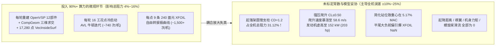

# WingDesignHub (V0.3.0) 全方位航空技术与软件工程审阅报告

- **审阅对象**：`WingDesignHub` V0.3.0（提交基线 `f8fc6bc`）
- **审阅视角**：航空总体/气动/结构多学科设计（MDO）专家 + 资深软件架构与产品工程专家
- **审阅日期**：2026-11-17
- **审阅原则**：基于仓库全量源码（98 个源码文件、约 9,160 行代码）、验证记录（`validation/`、`docs/VALIDATION_*.md`）与开发日志（`docs/PROGRESS.md`）做实证审查；只出具有据可查的诊断与改进方案，不改动现有业务代码。

---

## 执行摘要与总体评分卡

### 核心结论

`WingDesignHub` 在**工程诚实性与数值可追溯纪律**上表现极为出色：严格执行 SI 单位制、显式区分几何坐标系与机体坐标系、建立质量/燃油/阻力唯一归属台账、绝不用零值或静默外推掩盖求解器失败，且诚实区分了“软件阶段检查通过”与“独立物理验证未完成（`physical_validation_passed: false`）”。同时，项目在 V0.1.5 后及时叫停了早期偏向孤立结构工具验证的倾向，在战略上回到了“少量需求 → 正向总体设计 → 三方案比较”的产品主线。

但从资深航空总体设计与软件工程的双重标准审视，当前 V0.3.0 在战术落地上陷入了**三大核心困局**：

1. **航空物理层面的“精度倒挂（Fidelity Inversion）”与“以算代设”**：在仅占总阻力约 **4%–16%** 的翼尾剖面阻力上动用了数千次在线 240 面元 XFOIL 边界层迭代与每轮三维网格求交；却放任未标定的起落架圆管支柱假设（`CD = 1.2`）吃掉全机 **31.12%** 的总阻力，放任简化站位把重心推到机翼前缘附近的 **`5.17% MAC`**，并为了迁就小迎角线性气动模型强行把爬升速度抬高至接近巡航速度（**`58.6 m/s`**），导致发动机功率与空重定尺寸结果偏离真实通航飞机物理规律。
2. **计算架构层面的“暴力子进程风暴”与“归档膨胀”**：放弃了线性涡格法（VLM）与固定翼型极曲线在概念设计阶段天然具备的降阶/代理特性，在内外迭代中层层同步拉起外部进程——比较 3 个常规单发概念方案竟需启动 **约 9,800+ 次外部进程**、耗时 **160 分钟（2 小时 40 分钟）**、产生 **10.6 万个底层文件**与 **537.8 MiB** 双层压缩方案包，直接诱发 Windows 页面文件耗尽（Error 1455）与界面假死。
3. **产品交互层面的“开发者审计视角绑架终端用户”**：主界面“新建飞机方案”把 V0.1.6–V0.3.0 各阶段历史按钮呈“俄罗斯套娃”式纵向堆叠在同一页面（12 个计算入口、24+ 处原始 `st.json`、大量英文变量名与 64 位 SHA-256 哈希直出）；侧边栏混杂 5 个与主方案零连通的早期矩形翼演示页；默认增强模式强依赖的 Julia/CCBlade 甚至无法在“工具设置”界面配置。

### 六维健康度评分

| 审阅维度 | 评级 | 得分（/100） | 一句话诊断 |
|---|---:|---:|---|
| **1. 产品方向与初衷对齐度** | B | **74** | V0.1.6 后主线已纠偏，但 24.8% 早期结构代码仍孤立悬空，且重型归档背离概念设计“快速权衡”初衷 |
| **2. 航空概念设计建模均衡性** | C | **58** | 严重“精度倒挂”：微观条带黏性计算极深，但起降距离、增升襟翼、重心包线、机身力矩等一级约束缺失或失真 |
| **3. 技术路线复杂度与运行效率** | D+ | **48** | 嵌套子进程风暴 + 浮点缓存击穿 + 双重 ZIP 打包，把秒级/分钟级概念权衡做成了近 3 小时重型批处理 |
| **4. 单元模块验证与准入严谨性** | B- | **66** | 数值自洽、守恒与上游回归验证极严（95 分），但目标单发机型独立物理标定严重缺位（20 分），存在超域接入 |
| **5. 非专业用户与中文交互体验** | C- | **52** | 单页 12 入口迷宫、英文键名/JSON/哈希刷屏、单位制割裂、长任务阻塞且切换页面会泄漏孤儿进程 |
| **6. 软件架构、可维护性与可部署性** | C | **60** | 98 文件平铺单目录、15 套服务样板代码复制、8 套外部运行环境严苛锁死版本、CI 跳过全部原生求解器测试 |

---

## 一、方向审阅：开发方向是否偏离最初目的？

对照项目初衷（`AGENTS.md`、`docs/FORWARD_DESIGN.md`：**面向零代码基础工程人员，针对常规亚声速金属活塞螺旋桨飞机，由少量需求一键完成正向总体定尺寸、约束余量检查与方案比较，逐步覆盖 AAA 十模块**），结论是：**大战略在 V0.1.6 完成了关键纠偏，但当前版本仍存在三处明显的结构性偏离。**

### 1.1 值得肯定的战略纠偏
- **V0.1.5 的及时刹车是正确的**：V0.1.0–V0.1.5 曾沿“悬臂梁 → OpenAeroStruct 大展弦比客机管梁 → OpenVSP 半翼壳网格 → CalculiX 静力 → 板线性特征值屈曲”一路深挖局部结构工具。团队在 V0.1.5 敏锐识别出“长期停留在工具集合”的风险，于 V0.1.6–V0.2.0 迅速补齐了三种起飞重量语义（规定值/上限/待求）、四类任务剖面、确认哈希与三方案比较主线。

### 1.2 当前存在的三大方向性偏离

1. **近四分之一代码（22 个模块、2,249 行）沦为与主产品零连通的“历史孤岛”**
   - 经全仓 AST 依赖图核查，V0.1.0–V0.1.5 开发的 22 个结构与载荷模块（[model.py](file:///c:/proj/AAA_Design/src/wingdesignhub/model.py)、[fea_mesh.py](file:///c:/proj/AAA_Design/src/wingdesignhub/fea_mesh.py)、[vsp_structure_worker.py](file:///c:/proj/AAA_Design/src/wingdesignhub/vsp_structure_worker.py)、[shell_static.py](file:///c:/proj/AAA_Design/src/wingdesignhub/shell_static.py)、[flight_loads.py](file:///c:/proj/AAA_Design/src/wingdesignhub/flight_loads.py)、[plate_buckling.py](file:///c:/proj/AAA_Design/src/wingdesignhub/plate_buckling.py) 等，占 Python 总代码量的 **24.8%**）**没有任何一个函数被 V0.1.6–V0.3.0 的飞机设计主流程调用**。
   - 这些模块全部写死为**孤立无梢根比 NACA0012 矩形半翼**或理想平板，甚至包含超音速/跨声速大型客机 `CRM` / `uCRM` 翼盒回归算例（[oas_wingbox.py](file:///c:/proj/AAA_Design/src/wingdesignhub/oas_wingbox.py#L16-L31)，含激波阻力 `with_wave=True` 与 25 吨燃油），却在主界面侧边栏（[app.py](file:///c:/proj/AAA_Design/app.py#L19)）占据了 **9 个顶级导航项中的 5 个**，严重稀释了主产品心智。

2. **AAA 十模块推进节奏失衡：跳过概念设计生死线约束，过早沉入高成本微观数值耦合**
   - 在 DARcorp AAA（Roskam Part I / Part II）概念设计体系中，决定一架单发活塞螺旋桨飞机翼面积 $S$、发动机功率 $P$ 和尾翼面积 $S_H, S_V$ 的**核心一级控制约束**包括：**失速速度、起飞滑跑与 15 m（50 ft）越障距离、着陆距离、海平面与巡航爬升率/爬升梯度、巡航速度、以及前/后重心极限剪刀图（X-Plot / Scissor Plot）**。
   - 当前 V0.3.0 在**尚未建立起降场长约束、襟翼增升模型、重心包线与尾翼气动定尺寸**的前提下，先把三维 CAD 相交湿面积、120 条带射线遮蔽采样、240 面元 XFOIL 自由转捩边界层和 48 径向站位叶素动量理论（CCBlade）硬耦合进了最内层定尺寸循环。这相当于“地基的四根承重柱还缺两根，却先把外立面瓷砖缝隙用激光干涉仪测到了微米级”。

3. **把“概念设计敏捷探索工作台”异化成了“重型全量文件取证系统”**
   - 概念设计软件的核心生命力在于**让总体工程师在几秒至一两分钟内完成数十组参数权衡（Trade Study）**。
   - 当前为实现极端原教旨的“每轮试算原始输入输出全量留痕”，三方案对比一次需要 **160 分钟**（[VALIDATION_V0.3.0.md](file:///c:/proj/AAA_Design/docs/VALIDATION_V0.3.0.md#L20)），落盘 **537.8 MiB** 方案包。工程师调整一次展弦比或巡航速度就要等将近 3 小时，实质上丧失了概念阶段交互式方案探索的工程实用性。

---

## 二、技术路线审阅：是否存在局部切入过深与不必要的复杂化？

**审阅结论：存在非常典型的“局部切入过深”与“明明可以用标准概念解析/降阶方法干净解决，却采用了高脆弱度、高耗时的暴力数值嵌套”。**

### 2.1 航空物理层面的“精度倒挂”与连锁失真（实证剖析）

1. **31.12% 的总阻力来自拍脑袋的圆管支柱，却用上千次 XFOIL 去抠 4% 的尾翼剖面阻力**
   - 在 V0.2.4/V0.3.0 阻力账目中（全机 $C_D = 0.04022$，$L/D = 11.86$），主翼+平尾+垂尾全部 XFOIL 黏性剖面阻力合计仅占总阻力的 **15.86%**（其中平尾+垂尾合计仅约 **4%**；XFOIL 面元从 160 加密到 240，全机总阻力仅变化 **0.087%**）。
   - 反观起落架建模（[aircraft_vsp_worker.py](file:///c:/proj/AAA_Design/src/wingdesignhub/aircraft_vsp_worker.py#L76-L82)、[aircraft_drag.py](file:///c:/proj/AAA_Design/src/wingdesignhub/aircraft_drag.py#L35)）：模板虽然是带流线型轮罩（`Fairing`）的低翼前三点飞机，却用长细比 12 的粗 `POD` 模拟三根起落架支柱（主起支柱直径达 6.9 cm），并直接乘以**无整流裸圆柱亚临界横流阻力系数 `strut_crossflow_cd = 1.2`**（真实通航流线型包覆支柱或扁钢板簧腿折算正面 $C_D$ 通常仅为 $0.12\text{–}0.30$，见 Hoerner Ch.6 / Roskam Part VI）。
   - 结果：**仅三根起落架腿就贡献了 $\Delta C_D = 0.01252$，占全机总阻力的 `31.12%`，几乎是全机机翼+尾翼黏性阻力的 2 倍！** 该系数在 `0.8–1.6` 之间波动即可引起全机需油量 **`±10.23%`** 的变化，完全淹没了引入整套 AVL+XFOIL 带来的模型改进量（`-6.51%`）。

2. **为迁就小迎角求解器强行篡改爬升速度（`CL ≤ 0.50`），导致全机功率与重量定尺寸严重虚高**
   - 由于 AVL/XFOIL 配平限制在 `|α| ≤ 6°`，[aero_feedback.py](file:///c:/proj/AAA_Design/src/wingdesignhub/aero_feedback.py#L61-L64) 引入了 `schedule_cl_ceiling = 0.50`，强行将爬升速度和留空速度的下限锁定在 $C_L \le 0.50$ 对应的速度。
   - 在基准方案 A（载荷 350 kg、航程 800 km、巡航 216 km/h = 60 m/s）中，该限制迫使爬升真空速从正常的最佳爬升速度 $V_y \approx 45.5\text{ m/s}$（$C_L \approx 0.83$）飙升至 **`58.61 m/s`（211 km/h，几乎等于巡航速度！）**（见 [PROGRESS.md](file:///c:/proj/AAA_Design/docs/PROGRESS.md#L89)）。
   - 航空飞行力学基本常识表明：废阻需用功率 $P_{\text{parasite}} = D_0 V \propto V^3$。以 `58.6 m/s` 高速爬升使寄生功率暴增 **$(58.6/45.5)^3 = 2.13\times$**，叠加 `CD = 1.2` 的支柱大阻力，直接把功率控制约束扭曲为“2000 m 巡航高度高速爬升”，迫使这架巡航仅 117 节的四座单发机装上了 **`151.7 kW`（`203.4 hp`）** 的大发动机（发动机装机质量达 **`209.4 kg`**，空重达 **`788.4 kg`**，[validation/v0.3.0.json](file:///c:/proj/AAA_Design/validation/v0.3.0.json#L16-L28)）——作为参照，真实同级别 **Piper PA-28-181 Archer II** 仅用 **180 hp（134 kW）**、空重约 **650 kg** 即可实现 **128 节（237 km/h）** 巡航！

3. **粗糙固定重心站位（`5.17% MAC`）引发平尾大负舵偏，反过来打崩 XFOIL 边界层求解器**
   - 查看 [sizing.py](file:///c:/proj/AAA_Design/src/wingdesignhub/sizing.py#L14-L23) 的重心台账：推进系统（`232.4 kg`）放在机头 `0.12 Lf`（`0.90 m`），机体统包放在 `0.44 Lf`（`3.30 m`），而全部有效载荷（`350 kg`）与全部燃油（`82.6 kg`）不区分前后排乘员和行李舱，统统叠放在机翼四分之一弦点 `0.39 Lf`（`2.925 m`）。
   - 这导致方案 A 的起飞重心落在 **`x = 2.650 m`，折合平均气动弦位置仅为 `5.17% MAC`**（正常常规布局通航飞机重心包线位于 **`18%–32% MAC`**）！重心跑到接近机翼前缘的位置，造成静稳定裕度高达 `>45% MAC` 的极度“头重（Nose-heavy）”状态。
   - 为了配平如此靠前的重心，平尾在常规巡航/爬升中也不得不产生逾 `-1,100 N` 的巨大下洗负升力，升降舵长期偏转在 **`-6.5° ~ -8.0°`**。当规定起飞重量降至 `1100 kg`（发动机占比更高、重心更靠前）时，平尾升降舵偏角达到 `-7.99°`，XFOIL 的 `GDES FLAP` 折角在铰链处产生尖锐逆压梯度峰值，导致自由转捩迭代出现 `TRCHEK2/N2 NaN` 并在 60 秒后超时崩溃（[VALIDATION_V0.3.0.md](file:///c:/proj/AAA_Design/docs/VALIDATION_V0.3.0.md#L59)）——**使得系统连“1100 kg 规定起飞重量装不下 350 kg 载荷和 800 km 燃油”这么基础的总体重量预算诊断都被迫中断报错为 `polar_failed`！**

### 2.2 算法与工程实现层面的五大“不必要复杂化”及简化正道

单方案 14–15 轮迭代耗时 52–55 分钟、三方案耗时 160 分钟的根源如下表所示：

| 过度复杂环节 | 当前代码做法与实测代价 | 为什么不必要 | 推荐的概念设计标准简化方案 |
|---|---|---|---|
| **1. 每个工况点重复冷启动外部 AVL 牛顿迭代** | [aircraft_trim.py](file:///c:/proj/AAA_Design/src/wingdesignhub/aircraft_trim.py#L119-L135)：每轮 16 个 `(质量, 高度)` 点均从 `(α=3°, δe=0°)` 冷启动 Python 牛顿法，每步重启一次 `avl.exe` 并全量解析涡元文件 `elements.mrf`，**单机启动 ~700 次 `avl.exe`**；且无留空段的 `range_only` 任务每轮也白算留空分支。 | 在低亚声速线性涡格法（$M \le 0.18$）中，固定外形下的气动导数与诱导阻力极曲线二次型 $C_{Di}(C_L, \delta_e)$ **与飞机质量、大气密度完全无关**，重心移动仅需做精确平行轴力矩平移（[aircraft_geometry.py](file:///c:/proj/AAA_Design/src/wingdesignhub/aircraft_geometry.py#L40-L46)）。 | 每轮几何只跑 **3 次 AVL 基准状态**（或直接使用 AVL 原生配平指令 `A C CL` + `D1 PM 0`），提取线性气动矩阵与二次诱导阻力系数，在 Python 内存中微秒级解析求解任意 `(质量, 重心, 高度)` 配平点，**AVL 调用次数减少 95% 以上**。 |
| **2. 在线高频调用 XFOIL + 64 位浮点数打穿缓存** | [aircraft_drag.py](file:///c:/proj/AAA_Design/src/wingdesignhub/aircraft_drag.py#L133-L146) + [xfoil_polars.py](file:///c:/proj/AAA_Design/src/wingdesignhub/xfoil_polars.py#L128)：每配平点对三翼面查 9 条 240 面元极曲线（**单机 2,000+ 次查询、1,300+ 次 `xfoil.exe`**）。缓存键直接对未取整的 64 位浮点 `reynolds` 和 `flap_deg` 求 SHA-256！ | 外层机翼弦长每轮微变 `0.003%` 就会使 `Re` 浮点末位变化，**100% 击穿历史缓存**；平尾每个配平点 `δe` 浮点值不同，**缓存命中率为 0%**！且机翼和尾翼本就是固定 `NACA 2412` 与 `NACA 0012`（另外 [aircraft_drag.py](file:///c:/proj/AAA_Design/src/wingdesignhub/aircraft_drag.py#L138) 用 `local/cache/xfoil`，而 [ccblade_adapter.py](file:///c:/proj/AAA_Design/src/wingdesignhub/ccblade_adapter.py#L61) 却用 `local/xfoil-cache`，缓存路径自相矛盾）。 | 针对模板翼型（`NACA 2412` / `NACA 0012`）**离线预生成并校验一张固定网格多维标准气动表** `(Re, Mach, δe, cl)` 随包携带（仅在用户自定义新翼型时在线建表），定尺寸循环内**零 `xfoil.exe` 调用、零边界层发散风险**。 |
| **3. 每轮迭代启动 2 次 OpenVSP 做布尔求交与万点采样** | [feedback_native.py](file:///c:/proj/AAA_Design/src/wingdesignhub/feedback_native.py#L29) + [drag_geometry_worker.py](file:///c:/proj/AAA_Design/src/wingdesignhub/drag_geometry_worker.py#L50-L105)：每轮启动两次子进程建 12 部件、写出并重读 `.vsp3`、生成三维显示网格、跑 `CompGeom` 网格相交、并对 120 个条带做 `12×12 = 17,280` 点 `VecInsideSurf` 内外检测。 | 常规低翼梯形翼+固定宽 1.2 m 椭圆机身模板下，翼根遮蔽边界是简单初等几何关系（实测采样加密仅差 `0.036%`）；中间第 1~13 轮试算的显示网格和 HTML 报告完全没人看。 | 定尺寸外层循环内采用与模板严格一致的**解析暴露面积与湿面积公式**；待总体收敛后，**仅调用 1 次 OpenVSP** 生成最终 `.vsp3`、三维预览网格并进行一次精确 `CompGeom` 复核。 |
| **4. 过度严苛的 Picard 固定点收敛门槛** | [sizing.py](file:///c:/proj/AAA_Design/src/wingdesignhub/sizing.py#L62-L74)：固定松弛因子 `0.75`，要求连续 3 轮状态相对变化 `< 1e-4`（`0.01%`）。在方案 A 第 12–14 轮，起飞重量仅变化 **35–58 克**，仍在全套重跑 OpenVSP/AVL/XFOIL！ | FAST-GA 经验空重公式本身的物理标准差约为 `±8%–10%`（即 `±60–80 kg`）。为消除几十克的迭代尾差而多跑 4–5 轮全套高阶求解器毫无工程收益。 | 引入多保真度/信赖域策略或 Aitken $\Delta^2$ 加速：当外层几何尺寸相对变化 `< 0.2%` 时冻结气动/桨图灵敏度做快速内收敛，总迭代轮数可从 15 轮压缩至 **3–4 轮外更新**。 |
| **5. 下一阶段 V0.3.1–V0.4.0 结构路线的重大潜在陷阱** | V0.1.2–V0.1.5 探索了 OpenVSP `FeaMesh` 壳网格 → CalculiX `S6` 静力 → `S8R` `*BUCKLE` 特征值屈曲（无梁缘条、无加筋光板导致屈曲指标超限 `14.27` 倍，且五肋中心交线即产生零面积退化单元）。 | 若在 V0.3.2/V0.3.3 将 `FeaMesh + CalculiX` 壳有限元直接塞入总体迭代，必然遭遇频繁网格退化失败、无长桁薄蒙皮虚假屈曲与算力二次爆炸。 | **严禁将三维壳有限元放入总体定尺寸主循环！** V0.3.1–V0.3.3 应采用航空总体标准的**展向多站位金属双梁加筋翼盒解析/半解析定尺寸**（上下缘条截面积抗弯 $M_x$ + 腹板抗剪 $V_z$ 与 Bredt 闭室抗扭 $T_y$ + 蒙皮/长桁间距按 NACA TN 3781 压剪屈曲定厚），毫秒级精确回写机翼结构质量与展向重心；CalculiX 仅作为收敛方案的可选单点校核导出。 |

> [!TIP]
> **量化减负预期**：仅实施上述第 1～4 项工程简化（不降低任何有效物理模型阶数，甚至因消除 XFOIL 在线发散而更稳健），三方案增强对比的运行时间即可从 **160 分钟压缩至 1～3 分钟以内（提速 50～100 倍）**，彻底回归概念设计交互式工作台的应有体验。

---

## 三、模块验证审阅：单元模块是否未经有效验证就接入总框架？

**审阅结论：项目在“软件接口正确性、数值守恒与上游算例回归”上做到了极致（几乎无懈可击），但在“面向目标机型（单发活塞通航飞机）的物理有效性验证与经验域审查”上存在明显缺口，多个模块在缺乏本级别物理标定、甚至存在跨模块参数不一致和经验域越界截断的情况下直接驱动了 V0.3.0 闭环。**

虽然代码诚实地在所有输出中标注了 `"physical_validation_passed": false`，但当这些模块耦合形成“增强总体方案”并作为默认三方案比较引擎呈现给非专业用户时，其未标定偏差会产生强烈的误导性精确感（如小数点后三位的 `1220.542 kg`）。逐模块核查如下：

| 已接入闭环模块 | 已完成的验证（软件/数值/上游回归） | 未验证即接入总框架的物理缺口与隐患（代码实证） |
|---|---|---|
| **1. FAST-GA 1.4.0 部件重量组** ([fastga_mass.py](file:///c:/proj/AAA_Design/src/wingdesignhub/fastga_mass.py)) | • 复现双发 Beechcraft 76 教程回归值（误差 `<1e-5 kg`）； • 发现并打补丁修复了上游 `FurnitureMass` 导数错误与 `ComputeReserve` 导数严重错误（差 $5.2\times 10^7$ 倍）； • 校验部件质量之和严格等于 OWE。 | • **零单发活塞机型物理对标**：从未在 PA-28-181、Cessna 172S、Cirrus SR20 等公开单发机型上校核过空重精度；在 1220 kg 四座单发方案上算出空重 `788.4 kg`（其中系统重达 `197.2 kg`、装机发动机 `209.4 kg`），明显偏离同类真实金属单发机（约 `640–690 kg`）。 • **经验公式超域静默截断**：V0.1.1 已发现 FAST-GA 平垂尾面积比上限 `S_h/S_v ≤ 1.975` 的 Roskam 经验裁剪警告，但 V0.3.0 方案 A 的模板输出 `S_h/S_v = 3.96 / 1.66 = 2.382 > 1.975`，在未告警情况下直接触发上游边界截断。 • **跨模块几何参数自相矛盾**：[fastga_mass.py](file:///c:/proj/AAA_Design/src/wingdesignhub/fastga_mass.py#L26) 传给重量模型的平/垂尾相对厚度为 **`0.10`**、垂尾展弦比为 **`1.8`**；而 [aircraft_geometry.py](file:///c:/proj/AAA_Design/src/wingdesignhub/aircraft_geometry.py#L58-L91) 实际生成的 OpenVSP/AVL/XFOIL 尾翼相对厚度却是 **`0.12`**（NACA0012）、垂尾展弦比为 **`1.6`**！ |
| **2. OpenVSP 全机参数化几何** ([aircraft_geometry.py](file:///c:/proj/AAA_Design/src/wingdesignhub/aircraft_geometry.py)) | • `.vsp3` 写出重读精度 `<1e-6`； • `DegenGeom` 面积/弦长积分一致性； • 官方 `InsideSurf` API 测试通过。 | • 模板将机翼安装角、机翼扭转（Washout）、机翼上反角、平尾安装角全部硬编码为 **`0°`**（真实通航机通常设 $+2^\circ\text{–}3^\circ$ 机翼安装角、$-2^\circ$ 几何扭转、$5^\circ\text{–}7^\circ$ 低翼上反角、负平尾安装角以减小巡航机身迎角和升降舵配平偏角）； • 机身宽 `1.2 m`、高 `1.35 m`、螺旋桨直径 `1.9 m` 在 2～6 座和 `40–400 kW` 范围内完全冻结不变。 |
| **3. AVL 3.40 升力面与纵向配平** ([avl_aircraft.py](file:///c:/proj/AAA_Design/src/wingdesignhub/avl_aircraft.py), [aircraft_trim.py](file:///c:/proj/AAA_Design/src/wingdesignhub/aircraft_trim.py)) | • 椭圆翼解析诱导阻力对照（差 `-1.18%`）； • 三档网格收敛性（`<0.13%`）； • 与 AVL 原生配平及 MIT Vanilla 算例对照。 | • 完全忽略机身/发动机短舱失稳俯仰力矩 $\Delta C_{m\alpha,\text{fus}} > 0$（通常使全机中性点前移 `5%–12% MAC`）及螺旋桨滑流对平尾动压/下洗的影响； • 未经任何真实飞机纵向静稳定裕度或飞行配平舵偏曲线校核，即直接输出大负舵偏驱动尾翼黏性阻力。 |
| **4. XFOIL 6.99 剖面与全机寄生阻力** ([aircraft_drag.py](file:///c:/proj/AAA_Design/src/wingdesignhub/aircraft_drag.py)) | • 面元/极曲线/遮蔽采样加密收敛（`<0.6%`）； • 15 项阻力分项加总误差 `<1e-10`； • 公开低速风力机翼型 `UIUC E387`（$Re=3\times 10^5, 5\times 10^5$）对照（偏差 `-15.87% ~ -1.18%`）。 | • **本机所用翼型零风洞对照**：主翼 `NACA 2412` 与带 `0.7c` 铰链偏转的 `NACA 0012` 在 $Re = 2.4\times 10^6\text{–}5.8\times 10^6$ 下有经典的 **NACA TR-824（Abbott & Doenhoff）** 实验数据，却未做对照；且金属铆接蒙皮默认采用 `trip = 1.0` 全自然层流转捩（强制前缘转捩会使总阻力增加 `+11.2%`）。 • **整机新阻力模型从未跑过公开巡航对标**：V0.1.8 的 PA-28-181 巡航速度对照（`+6.14%` 偏差）检验的只是旧版 `CD0 = 0.032` 抛物线模型，**V0.2.4–V0.3.0 的 OpenVSP+AVL+XFOIL 整机阻力账目从未在任何真实飞机同构型巡航点上检验过合理性**！ |
| **5. CCBlade 1.0.0 合成螺旋桨** ([ccblade_adapter.py](file:///c:/proj/AAA_Design/src/wingdesignhub/ccblade_adapter.py), [ccblade_worker.jl](file:///c:/proj/AAA_Design/src/wingdesignhub/ccblade_worker.jl)) | • 复现上游教程 `APC 10×5` 航模小电桨（直径 `0.254 m`）17 点算例（$C_T/C_P/\eta$ 最大误差 `13.69%/12.58%/7.10%`）； • $P=Q\Omega$ 恒等式与径向离散加密（`<0.3%`）。 | • **航模桨验证不能外推全尺寸金属定距/恒速桨**：合成 `1.9 m` 三叶 `NACA 4412` 螺旋桨未计及粗大机头整流罩阻塞损失与滑流洗刷阻力，算出的全任务推进效率高达 **`84.75%–86.70%`**（比常规单发活塞飞机真实装机净推进效率高出约 `5%–10%`）。 • [ccblade_adapter.py](file:///c:/proj/AAA_Design/src/wingdesignhub/ccblade_adapter.py#L58) 将翼型极曲线硬编码在 `Re = [50万, 75万, 100万, 200万]`，一旦用户在允许范围内调小桨尖弦长（如 `0.04 m`），桨尖局部雷诺数跌破 50 万会导致整张桨图全部判为越界失效。 |
| **6. FAST-GA 通用活塞发动机耗油图** ([engine_fuel.py](file:///c:/proj/AAA_Design/src/wingdesignhub/engine_fuel.py)) | • 上游 3 组单元测试与 330 个网格节点插值精度（`8.88e-16`）。 | • V0.2.0 刚用 PA-28 手册审慎标定了平飞经济耗油率并指出与 Lycoming 手册存在约 25% 安装/混合比差异；V0.2.7 却直接用 FAST-GA 内置 `FourCylindersAtmospheric.csv` 通过虚拟体积 `V_equivalent` 在 `40–400 kW`（`54–536 hp`）范围做无标定橡皮缩放，直接将方案 A 总可用油从 `109.4 kg` 砍到 **`82.6 kg`（骤降 `-24.5%`）**，且缺乏任何真实 Lycoming/Continental 台架曲线验证。 |

---

## 四、界面与易用性审阅：是否充分考虑非专业用户与中文用户？

对照 `AGENTS.md` 明确设定的目标受众（**“用户以零代码基础工程人员为主。提供 Windows 双击启动、本地中文界面、示例和清楚的错误提示；终端不是正常使用的必需入口”**），当前 UI 与报告层的实际体验与该目标存在显著落差。

### 4.1 信息架构混乱：侧边栏真假入口混杂，主页面“俄罗斯套娃”式堆叠

1. **顶层侧边栏导航严重误导新用户**（[app.py](file:///c:/proj/AAA_Design/app.py#L19)）
   - 侧边栏平铺 9 项：`["新建飞机方案", "开始计算", "结构网格", "机翼静力", "载荷与屈曲", "代表板屈曲", "公开基准算例", "工具设置", "验证与路线图"]`。
   - **“新建飞机方案” vs “开始计算”陷阱**：用户在第 1 项“新建飞机方案”填好需求后，极易点击侧边栏第 2 项 **“开始计算”**——结果进入的却是 V0.1.0 遗留的孤立矩形翼悬臂梁解析验证页，与刚才填的飞机方案毫无关系！随后 4 个结构页面同样全部是孤立 NACA0012 矩形翼/平板演示，全站衍生出 **8 种互不兼容的 `.json` / `.wdh` 上传下载格式**。
   - **“验证与路线图”页链接失效**（[app.py](file:///c:/proj/AAA_Design/app.py#L300-L302)）：直接将 `docs/` 下 4 份内部 Markdown 原文拼接渲染，文中大量相对文档链接（如 `[FASTGA_INTERFACE.md]`）在 Streamlit 路由中点击即失效。

2. **“新建飞机方案”单页塞入 12 个运行按钮、25+ 个折叠面板与 40+ 个下载按钮**
   - 追踪 [design_ui.py](file:///c:/proj/AAA_Design/src/wingdesignhub/design_ui.py) 及其级联调用树，每次迭代新增的里程碑入口都没有做流程整合，而是层层往同一个页面下方追加：
     - **同页四套相互竞争的计算路线**：① `运行初步总体设计` → ② `运行推进闭环总体计算`（V0.2.7） / ③ `运行气动反馈总体计算`（V0.2.5）→ ④ `运行推进模型任务复算`（V0.2.6） / ⑤ `生成全机几何`（V0.2.1）→（⑥ `运行全机气动` V0.2.2 ∥ ⑦ `求解纵向配平` V0.2.3 → ⑧ `计算阻力账目` V0.2.4） / ⑨ `一键计算并比较三个方案`（V0.3.0）。非专业用户完全无法分辨哪些是正式推荐主流程、哪些是单点调试子工具。
     - **页面顺序倒置与开发验证按钮裸露**：V0.1.6 遗留的 `检查并保存需求` 按钮（[design_ui.py](file:///c:/proj/AAA_Design/src/wingdesignhub/design_ui.py#L92)）排在总体计算结果和保存控件之后；主页上还直接放着 `开发接口与参考任务的区别`、`核查耗油模型与留出数据`、`计算公开巡航点对照`、`复算 FAST-GA 公开参考任务`（算双发 Beechcraft 76）等纯开发自检入口。
     - **两个隐蔽的 UI 状态错位 Bug**（[sizing_ui.py](file:///c:/proj/AAA_Design/src/wingdesignhub/sizing_ui.py#L91-L98)）：
       - **三维预览画旧不画新**：`geometry_ui.render` 永远绑定在初步总体 `record` 上——用户跑完 50 分钟“推进闭环总体计算”（翼面积、翼展已更新）后点击下方“生成全机几何”看 3D 图，看到的其实是**闭环前的旧飞机尺寸**，而闭环后的新几何反而没有 3D 预览！
       - **计算结果莫名消失**：`coupled_ui` 的父种子 `seed` 会随 `aero_feedback_result` 动态切换。用户若先跑完推进闭环，再点下方的气动反馈，`parent_run_id` 失配会导致刚跑了近一小时的推进闭环结果直接从页面上消失！

### 4.2 中文化流于表面：英文代码键名、原始 JSON 与哈希码刷屏

1. **核心业务表格直接展示 Python 变量名与内部枚举**：
   - 主表单设计假设表（[design_ui.py](file:///c:/proj/AAA_Design/src/wingdesignhub/design_ui.py#L65)）直接显示 `cruise_speed_m_s`、`cruise_altitude_m`、`reserve_duration_s`、`reserve_basis`；任务段表（[design_ui.py](file:///c:/proj/AAA_Design/src/wingdesignhub/design_ui.py#L82)）显示 `main_route`、`outbound_and_return`、`on_station`。
   - 总体/闭环明细与打印报告直接把内部字典列表丢给 `st.dataframe()`，表头和内容充斥 `airframe`、`propulsion`、`furniture`、`unusable_fuel`、`native_engine_sfc_map`、`engine_map_low_load_base_bsfc`、`strut_cd_0.8`、`data:weight:aircraft:MTOW`（[sizing_ui.py](file:///c:/proj/AAA_Design/src/wingdesignhub/sizing_ui.py#L83-L85)、[coupled_ui.py](file:///c:/proj/AAA_Design/src/wingdesignhub/coupled_ui.py#L28-L29)、[design_ui.py](file:///c:/proj/AAA_Design/src/wingdesignhub/design_ui.py#L131)）。
2. **全站超过 24 处直接调用 `st.json(...)` 向零代码用户倾倒原始数据结构**：
   - 甚至在三方案转速设置区（[comparison_ui.py](file:///c:/proj/AAA_Design/src/wingdesignhub/comparison_ui.py#L102)）直接吐出整棵 `CoupledOptions` JSON 配置树。
3. **状态码映射不全与英文报错直出**：
   - [design_cards.py](file:///c:/proj/AAA_Design/src/wingdesignhub/design_cards.py#L6-L10) 的 `STATUS` 字典漏掉了 `polar_failed`、`polar_missing`、`trim_bounds_exceeded`、`ccblade_not_configured` 等大量状态码，导致中文方案卡标题栏直接印出英文 `polar_failed`（见 [validation/v0.3.0.json](file:///c:/proj/AAA_Design/validation/v0.3.0.json#L712)）；输入越界直接报 `stall_speed_m_s 超出当前概念模型范围 [22, 35]`（[sizing_config.py](file:///c:/proj/AAA_Design/src/wingdesignhub/sizing_config.py#L46)）。
4. **可打印 HTML 报告沦为“代码转储页”**：
   - **气动、配平、阻力三份 HTML 报告根本没有排版**（[aero_report.py](file:///c:/proj/AAA_Design/src/wingdesignhub/aero_report.py#L20)、[trim_report.py](file:///c:/proj/AAA_Design/src/wingdesignhub/trim_report.py#L21)、[drag_report.py](file:///c:/proj/AAA_Design/src/wingdesignhub/drag_report.py#L21)）：直接用 `<body><pre>` 包裹未渲染的 Markdown `# 标题`、`|竖线字符表|` 和原始 JSON！
   - **方案卡与总体/闭环报告**（[design_cards.py](file:///c:/proj/AAA_Design/src/wingdesignhub/design_cards.py#L85-L99)、[design_report.py](file:///c:/proj/AAA_Design/src/wingdesignhub/design_report.py#L21-L30)、[coupled_report.py](file:///c:/proj/AAA_Design/src/wingdesignhub/coupled_report.py#L12-L13)）：直接把 Python 字典字符串 `{'mass_budget_kg': -0.028195647225629727, 'upper_bound_kg': None, ...}`、数百行 `audit` JSON 以及**全部 97 个 `.py` 源码文件的 64 位 SHA-256 哈希列表**打印在正式报告正文里！
   - **工程可视化粗糙**：条带载荷图（[aero_report.py](file:///c:/proj/AAA_Design/src/wingdesignhub/aero_report.py#L28-L31)）把机翼展向坐标 `y` 与垂尾高度坐标 `z` 混画在同一根横轴上，图例显示英文 `MainWing (YDUP)`；二维平面草图（[sizing_worker.py](file:///c:/proj/AAA_Design/src/wingdesignhub/sizing_worker.py#L26-L27)）标题全英文且无重心/MAC 标注；缺少概念设计最核心的**约束定尺寸包线图（$W/S - W/P$ 图）**、**任务剖面图**和**阻力分项占比图**。

### 4.3 航空工程单位制割裂与表单交互脆弱性

- **速度与功率单位混乱**：主表单巡航速度填 `km/h`（[design_ui.py](file:///c:/proj/AAA_Design/src/wingdesignhub/design_ui.py#L56)），但失速速度、气动工况与报错提示（`'巡航速度 40–90 m/s'`，[sizing.py](file:///c:/proj/AAA_Design/src/wingdesignhub/sizing.py#L34)）全用 `m/s`，底部参考区又混用 `mph`、`kn`、`US gal/h`；活塞发动机功率只显示 `kW`（对比表 [coupled_worker.py](file:///c:/proj/AAA_Design/src/wingdesignhub/coupled_worker.py#L16) 甚至直接显示瓦特 `151656.9 W`！），缺少通航选型最直观的**马力（`hp`）**对照与燃油升数（`L`）折算；正式报告任务表使用原始秒 `14400 s` 和米 `800000 m`（[design_report.py](file:///c:/proj/AAA_Design/src/wingdesignhub/design_report.py#L21)）；结果主表只显示重心距机头米数，隐藏了后端已算出的 `% MAC`。
- **输入框无边界保护导致整块 UI 消失**：[sizing_ui.py](file:///c:/proj/AAA_Design/src/wingdesignhub/sizing_ui.py#L26-L27) 循环生成的 13 个 `st.number_input` 均未设 `min_value` / `max_value` / `step`。用户在 `CD0`（默认 `0.032`，上限 `0.05`）上按默认步长 `0.01` 点两下 `+` 变成 `0.052`，即触发 `ValueError` 跳过 [design_ui.py](file:///c:/proj/AAA_Design/src/wingdesignhub/design_ui.py#L74-L114) 整个渲染块，导致确认框、运行按钮、保存区和三方案面板瞬间全部消失；且全站没有“一键加载内置示例方案”按钮。

### 4.4 长耗时阻塞、孤儿进程泄漏与工具设置盲区

1. **长达 1～3 小时的同步阻塞无轮次进度、无 ETA、不可取消**：三方案比较默认选中耗时的 `coupled` 增强模式（[comparison_ui.py](file:///c:/proj/AAA_Design/src/wingdesignhub/comparison_ui.py#L93)），点击后阻塞 Streamlit 脚本线程 160 分钟；单方案推进闭环 50 分钟内仅有一个静态转圈图标 `st.spinner`，不读取子进程已落盘的 `iterations/00X.json` 轮次进度。
2. **致命的后台孤儿进程泄漏与结果丢失**（[adapters.py](file:///c:/proj/AAA_Design/src/wingdesignhub/adapters.py#L50-L67)）：
   - `execute()` 仅在 `subprocess.TimeoutExpired` 时杀死子进程树，**未在 `finally` 或 `BaseException` 中清理子进程**。用户在漫长等待中只要随手点击侧边栏切换页面、修改任意输入框或点击右上角 Stop，Streamlit 抛出的 `StopException`/`RerunException` 会直接中断前端脚本，而后台无窗口子进程（`coupled_worker` + `avl.exe` + `xfoil.exe` + `julia.exe`）会变成**无人管控的僵尸进程继续狂跑**；用户若再次点击运行，多套进程叠加极易耗尽系统虚拟内存提交上限（Windows Error 1455），且跑完的结果也无法在界面找回。
3. **“工具设置”页面完全漏配 Julia 与 CCBlade**（[app.py](file:///c:/proj/AAA_Design/app.py#L288-L299) vs [ccblade_adapter.py](file:///c:/proj/AAA_Design/src/wingdesignhub/ccblade_adapter.py#L13-L20)）：
   - 界面“工具设置”和 CLI `doctor` 只管理 `avl`、`xfoil`、`openvsp`、`calculix` 四个路径，**完全没有 Julia 与 CCBlade 1.0.0 的检测与配置入口**！零代码用户在新电脑双击安装脚本（英文提示）并配好界面上全部 4 个工具后，运行默认三方案会直接报错要求手写隐藏文件 `local/propulsion-tools.json`。

---

## 五、软件架构与代码质量审阅（其他关键工程问题）

### 5.1 扁平模块膨胀、高密度分号代码风格与样板复制

- **98 个文件平铺在单一命名空间**：`src/wingdesignhub/` 根目录下直接平铺了 **94 个文件**（外加 `fastga_plugins/` 4 个文件），未划分 `core`、`sizing`、`geometry`、`aero`、`propulsion`、`archive`、`reporting`、`ui`、`legacy_structures` 子包；甚至验证脚本直接反向导入 Streamlit UI 模块获取领域函数（`scripts/validate_enhanced_comparison.py:7` 导入 `wingdesignhub.comparison_ui.variants`）。
- **损害可读性的“人工压缩行数”编码风格**：大量文件为了控制表面行数，用分号 `;` 将多条语句挤在同一行、混用单字母变量并省略空行（如 [project_archive.py](file:///c:/proj/AAA_Design/src/wingdesignhub/project_archive.py#L153-L190)、[propulsion_feedback.py](file:///c:/proj/AAA_Design/src/wingdesignhub/propulsion_feedback.py#L114-L145)），显著增加了代码审查、断点调试与 Git 冲突合并成本。
- **严重的横向样板重复与脆弱的全量源码哈希门禁**：
  - **15 个 `*_service.py`** 各自重复手写了一遍运行目录创建、`result.json` 状态机、异常捕获与产物哈希遍历；`AeroFeedback` 与 `PropulsionFeedback` 约 75% 调度逻辑重复。
  - **8 处复制粘贴的全仓库 `source_hashes`** 对全部 97 个 `.py` 文件计算 SHA-256（却漏掉了实际参与计算的 `ccblade_worker.jl`！），下游服务硬性校验 `parent['source_hashes'] == current`——导致**哪怕只改了无关页面 `plate_ui.py` 里的一个中文标点符号，所有已收敛的总体和几何运行记录在重算下游任务时都会被判定为“源码已改变”而全部作废**！
  - **报告模板用字符串 `.replace()` 层层打补丁**：尽管环境已锁入 `Jinja2==3.1.6`，[design_report.py](file:///c:/proj/AAA_Design/src/wingdesignhub/design_report.py#L31)、[feedback_report.py](file:///c:/proj/AAA_Design/src/wingdesignhub/feedback_report.py#L19)、[coupled_report.py](file:///c:/proj/AAA_Design/src/wingdesignhub/coupled_report.py#L15) 却通过 `.replace('<h2>输入与假设快照</h2>', ...)` 连续两次做脆弱的 HTML 子串替换注入，且文本读写重编码引发了多起 Windows `CRLF` 与 `LF` 字节哈希不一致故障（见 `PROGRESS.md`）。

### 5.2 537.8 MiB 方案包存储爆炸与内存/哈希性能瓶颈

对正式生成的三方案档案包 `c38e399f1a1c4a99869f785d5d8fce73.wdh`（**537.80 MiB**）做逐项拆解，98.9% 的体积来自三个内嵌的 `native_evidence.zip`（合计约 **10.6 万个文件、原始大小 ~2.85 GiB**），其中充斥大量无意义的重复拷贝：
- **单方案内拷贝 244 份完全相同的 `aircraft.vsp3`（84.3 MiB/机）**：[feedback_native.py](file:///c:/proj/AAA_Design/src/wingdesignhub/feedback_native.py#L66) 在全部 230 个气动工况子目录中逐一复制 `.vsp3`，尽管第 1 个点之后根本不再调用 OpenVSP！
- **单方案内保存 920 份全机涡元 `elements.mrf`（285.6 MiB/机）与三份冗余的 `strip_loads.json`（190.6 MiB/机）**：每步牛顿试算都落盘完整涡元明细，接受后再复制两遍（`evaluations/00X/strip_loads.json` → `point_XXX/strip_loads.json` → `point_XXX/trim_strip_loads.json`）；每次 XFOIL 缓存命中还要把 7 个缓存文件再拷贝一份到当前工况目录（[xfoil_polars.py](file:///c:/proj/AAA_Design/src/wingdesignhub/xfoil_polars.py#L149-L150)）。
- **三重全量内存解压校验与 UI 渲染卡死**：
  1. [project_archive.py](file:///c:/proj/AAA_Design/src/wingdesignhub/project_archive.py#L129) 在 `build_bundle()` 末尾刚在内存生成 538 MiB ZIP，就立即调用 `read_bundle(result)` 把它全量读回内存字典并解压校验全部 10.6 万个内部文件；紧接着 `save_bundle()`（[project_archive.py](file:///c:/proj/AAA_Design/src/wingdesignhub/project_archive.py#L337)）**又对同一份 `bytes` 再调一遍 `read_bundle(data)`**！
  2. 更严重的是，[project_ui.py](file:///c:/proj/AAA_Design/src/wingdesignhub/project_ui.py#L148-L161) 在用户**尚未点击下载或保存按钮**时，每次页面重绘都会调用 `get_results()` 校验磁盘大文件，并将 **537.8 MiB 的 `bytes` 对象直接塞进 `st.download_button`** 内存缓冲池（导致超过 1.5–2.0 GiB 的瞬时内存尖峰，这正是 `PROGRESS.md` 记录浏览器下载调用卡顿长达 2,701 秒的根本原因）。
  3. [adapters.py](file:///c:/proj/AAA_Design/src/wingdesignhub/adapters.py#L46-L47) 在每次启动外部进程时都会重新从磁盘读取并计算 `avl.exe` / `xfoil.exe` / `python.exe` / `julia.exe` 的二进制 SHA-256，一次三方案对比重复哈希同一批可执行文件近万次。

### 5.3 跨平台/跨机器部署脆弱性与 CI 自动化盲区

- **8 套运行环境严苛锁死，工程推广门槛极高**：在另一台工程师的 Windows 电脑上复现完整功能，需同时满足 CPython `3.13.18`、单独编译匹配的 OpenVSP `3.56.0` Python 3.13 扩展包（任何小版本如 `3.56.1` 直接硬报错拒绝）、AVL `3.40`、XFOIL `6.99`、CalculiX `2.23`、Julia `1.12.4` + 预编译好的 `CCBlade 1.0.0`，以及对 `fast-oad-cs23==1.4.0` 内部私有属性与全局注册表的猴子补丁（[fastga_compat.py](file:///c:/proj/AAA_Design/src/wingdesignhub/fastga_compat.py#L48-L55)、[engine_fuel.py](file:///c:/proj/AAA_Design/src/wingdesignhub/engine_fuel.py#L20-L22)）。同时，`pyproject.toml` 将核心必需的 `fast-oad-cs23` 错放在可选依赖 `engineering` 下，而 `requirements-lock.txt` 却锁入了 `AeroSandbox`、`NeuralFoil`、`casadi`、`jupyterlab` 等数十个本项目根本未使用的重型包。
- **GitHub Actions CI 存在严重盲区**：[.github/workflows/tests.yml](file:///c:/proj/AAA_Design/.github/workflows/tests.yml) 未配置任何外部求解器，每次推送云端自动跳过约 32 项核心原生集成测试；且 [test_aircraft_aero.py](file:///c:/proj/AAA_Design/tests/test_aircraft_aero.py)、[test_aircraft_trim.py](file:///c:/proj/AAA_Design/tests/test_aircraft_trim.py)、[test_aircraft_drag.py](file:///c:/proj/AAA_Design/tests/test_aircraft_drag.py) 中硬编码检查 `'C:/apps/avl/avl.exe'` 而非调用 `tool_paths()`，换一台工具目录不同的机器即跳过或失败。

---

## 六、系统性改进与下一步演进建议（强烈建议在进入 V0.3.1/V0.4.0 前收口）

为避免将当前的“精度倒挂、算力风暴与界面堆叠”进一步带入 V0.3.1–V0.4.0 的结构闭环，建议按以下四个优先级有序展开完善：

### P0：立即止血与架构减负（目标：三方案增强对比从 160 分钟 / 538 MB 降至 < 3 分钟 / < 5 MB）
1. **气动与配平降阶提速**：
   - 同一外迭代几何仅运行 **3 次 AVL 基准状态**构建线性气动/配平矩阵与诱导阻力极曲线，内存解析求解各 `(质量, 重心, 高度)` 配平点；仅在实际存在的任务段上建表。
   - 为模板翼型（`NACA 2412`、`NACA 0012` 含舵偏网格）构建**离线验证过的标准多维气动极曲线表**随包分发（消除在线数千次 `xfoil.exe` 调用及铰链折角 `NaN` 崩溃）；同时统一 XFOIL 缓存路径并对查询键做合理有效数字量化。
   - 定尺寸迭代内采用解析暴露面积/湿面积，收敛后仅调用 **1 次** OpenVSP 生成最终 `.vsp3`、三维网格和 `CompGeom` 审计。
2. **修复子进程孤儿泄漏与后台任务机制**：
   - 在 [adapters.py](file:///c:/proj/AAA_Design/src/wingdesignhub/adapters.py) 的 `execute()` 中使用 `try ... finally`（或 Windows Job Object）确保收到 Streamlit `StopException` 或任何异常时立即终止整棵子进程树；缓存可执行文件二进制 SHA-256。
   - 将长耗时计算改为独立后台任务队列 + 轮询读取 `iterations/00X.json`，在界面提供**实时轮次进度条、当前残差曲线、已用时/预计剩余时间、“取消计算”按钮**以及断线重连后的**历史运行认领恢复入口**。
3. **瘦身 `.wdh` 方案包并解除渲染阻塞**：
   - 区分**轻量级工程方案包（`.wdh`，仅含输入、收敛结果、气动/桨图表、最终 `.vsp3` 与报告，控制在 `< 5 MB`）**与可选导出的**底层求解器调试证据包**；停止向每个 `point_XXX` 重复拷贝 `.vsp3`、`elements.mrf` 和缓存文件；严禁在每次 Streamlit 重绘时在内存中预打包数百 MB 字节流塞入 `st.download_button`，消除 `build_bundle` + `save_bundle` 的双重 `read_bundle` 校验。

### P1：航空物理模型纠偏与单发标定（消除“精度倒挂”）
1. **修正三大物理失真源**：
   - **修正起落架阻力模型**：区分带流线型整流包覆支柱与裸露支柱的横流阻力系数（或采用 Roskam/Hoerner 标准前三点固定起落架部件 $\Delta C_D S_{\text{ref}}$ 方法），消除 `CD = 1.2` 吃掉 31% 总阻力的反常现象。
   - **修正部件与乘员重心站位台账**：按真实单发通航布局拆分前排乘员、后排乘员、行李舱、机翼、机身、尾翼独立站位（使常规装载重心回到合理的 **`20%–30% MAC`** 区间），补充主翼安装角（如 `+2°`）与平尾安装角参数，并统一 `fastga_mass.py` 与 `aircraft_geometry.py` 的尾翼相对厚度/展弦比定义。
   - **解除 `CL ≤ 0.50` 爬升速度枷锁**：允许爬升段在真实最佳爬升速度 $V_y$（$C_L \approx 0.75\text{–}0.90$，对应迎角约 `5°–8°`）下工作，使发动机定尺寸功率回归真实水平。
2. **补齐一级概念定尺寸约束与单发基准对标**：
   - 优先补入 **CS-23/CCAR-23 起飞滑跑与 15 m 越障距离、着陆距离（含简单襟翼 $\Delta C_{L\max}, \Delta C_D, \Delta C_m$）、海平面爬升率与前/后重心静稳定/配平包线检查**。
   - 建立至少 **1～2 架公开单发金属飞机（如 Piper PA-28-181 Archer II、Cessna 172S）** 的端到端同条件对标测试集，检验空重、巡航阻力和推进耗油的整体闭合偏差，并对 FAST-GA 内部经验公式范围（如 `k_vh`）做显式监控告警。

### P2：面向零代码中文工程师重塑界面、单位与报告
1. **重构导航与主页面信息层级**：
   - 侧边栏明确分层为 **“飞机总体设计（主工作流）”**、**“单学科专项分析（高级）”**、**“方法验证与基准算例（开发/评审）”** 与 **“系统与工具设置”**（把 V0.1.0–V0.1.5 的孤立矩形翼演示移入专项/基准分类，消除“开始计算”歧义）。
   - 主页面改为清晰的 **四步向导/标签页（① 需求与假设［含一键加载示例］ → ② 总体定尺寸［秒级初步 / 深化闭环二选一模式开关，取代并列堆叠的 8 个中间按钮］ → ③ 三方案权衡对比 → ④ 报告与归档）**；修复闭环后三维几何预览数据源。
2. **彻底汉化表格、消灭裸 `st.json`、统一航空工程双单位显示**：
   - 所有面向用户的表格、状态标签、错误提示与图表图例 100% 映射为规范航空中文术语（原始 JSON 和 SHA-256 哈希全部收入折叠的“底层审计信息”或仅在导出调试包中提供）；为所有 `number_input` 补齐合法上下限、步长及越界友好提示。
   - 统一工程习惯显示：功率同时展示 **`kW（折合 xxx hp）`**，速度支持 `km/h` / `kt` / `m/s` 一致切换，燃油同时展示 **`kg（约 xxx L）`**，重心同时展示 **`m（xx.x% MAC）`**，任务报告时长与航程统一用 `h / min` 与 `km`。
3. **补齐“工具设置”与重做 HTML 工程报告**：
   - 在“工具设置”页面补齐 **Julia 与 CCBlade 环境检测、路径配置及一键可用性自检按钮**，将启动脚本提示汉化。
   - 用 `Jinja2` 模板重写全部 8 类 HTML 报告，彻底废除 `<pre>Markdown</pre>` 和大段源码哈希转储，新增**约束定尺寸包线图（$W/S - W/P$）**、**全机三视图/带重心与 MAC 标注的平面图**、**阻力分项饼图/柱状图**及**可操作的超限调参建议**。

### P3：代码包分层重构与正确切入 V0.3.1–V0.4.0 机翼结构闭环
1. **模块化重构与解耦**：将单目录 98 个文件拆分为清晰子包，提取统一的 `RunContext / ServiceRunner` 基类消除 15 套重复服务样板，将全仓 97 文件哈希门禁改为**按学科契约版本号 + 当前学科核心文件哈希**校验，清理 `requirements-lock.txt` 中未使用的重型依赖，并在 GitHub CI 中引入便携版 AVL/XFOIL/CalculiX 实现真正的端到端回归守护。
2. **以“解析加筋翼盒定尺寸 + 可选有限元复核”推进 V0.4.0**：
   - 在即将启动的 V0.3.1–V0.3.3 中，直接基于本机梯形翼几何、V-n 机动/阵风包线与机翼燃油/自重惯性卸载，构建**多站位双梁加筋金属翼盒快速解析定尺寸模型**（含上下缘条、腹板、肋距与加筋蒙皮压剪局部稳定性约束），替换 FAST-GA 机翼经验质量并联动重心；保留 CalculiX 壳/板有限元作为定型方案的独立高保真校核出口，做到**物理闭环严谨、计算毫秒级响应、工程易于理解与维护**。
